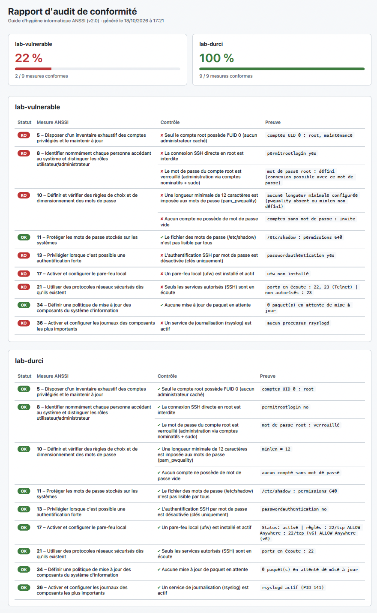

# Compliance Checker

Outil d'audit de conformité automatisé, écrit en Python. Il se connecte à des machines Linux, vérifie leur configuration de sécurité et rattache chaque résultat aux mesures du **Guide d'hygiène informatique de l'ANSSI**, avec une preuve pour chaque contrôle, un taux de conformité par machine et un rapport HTML.

Premier projet réalisé en « vibe coding », pour comprendre l'architecture d'un tel outil et les limites de cette approche : voir [Méthode de développement](#méthode-de-développement).



> Projet personnel en cours de développement : il évoluera vers une plateforme web de conformité et d'analyse de risques (voir la [feuille de route](#feuille-de-route)).

## Fonctionnalités

- **Vérifications techniques automatisées** via SSH : configuration SSH, pare-feu, mises à jour, permissions de fichiers sensibles.
- **Rattachement à un référentiel** : chaque vérification est liée à une mesure du guide ANSSI, décrite dans un fichier YAML séparé du code.
- **Preuve pour chaque résultat** : la valeur réellement observée sur la machine est conservée, comme dans un audit.
- **Audit de plusieurs machines** décrites dans un fichier de configuration, avec synthèse comparative.
- **Authentification par clé SSH** avec un compte d'audit dédié (élévation de privilèges via `sudo`), ou par mot de passe.
- **Vérification de l'identité des serveurs** : seules les machines dont l'empreinte est enregistrée dans `known_hosts` sont auditées, ce qui protège contre l'attaque de l'homme du milieu.
- **Aucun secret dans le code** : les mots de passe sont lus dans des variables d'environnement (fichier `.env` non versionné).
- **Rapport HTML** généré avec Jinja2, avec échappement des preuves pour empêcher toute injection de code (XSS) depuis une machine auditée.
- **Architecture à plugins** : une vérification = un fichier, découvert automatiquement par le moteur.
- **Robustesse** : une vérification en erreur ou une machine injoignable n'interrompt pas l'audit.
- **Lab Docker** fourni : une machine volontairement vulnérable et une machine durcie pour comparer les résultats.

## Résultat sur le lab

```
=== Synthèse ===
  lab-vulnerable       22 %
  lab-durci            100 %
```

Les mêmes vérifications, appliquées à deux configurations différentes, mesurent concrètement l'effet du durcissement.

## Architecture

```
compliance-checker/
├── lab/
│   ├── vulnerable/Dockerfile   # Cible mal configurée (root, compte sans mot de passe, UID 0 caché, Telnet…)
│   └── durci/Dockerfile        # Cible durcie (compte d'audit, clé SSH, pare-feu)
├── checks/                     # Une vérification = un fichier (11 au total)
├── referentiels/
│   └── anssi.yaml              # Correspondance mesures ANSSI ↔ vérifications
├── templates/
│   └── rapport.html            # Template Jinja2 du rapport
├── cibles.yaml                 # Machines à auditer
├── .env.exemple                # Modèle du fichier de secrets (.env, non versionné)
├── connexion.py                # Connexion SSH (clé ou mot de passe) et exécution
├── rapport.py                  # Génération du rapport HTML
└── main.py                     # Moteur d'audit
```

**Fonctionnement :**

1. `main.py` découvre automatiquement les vérifications présentes dans `checks/`.
2. Pour chaque machine de `cibles.yaml`, il ouvre une connexion SSH et exécute toutes les vérifications.
3. Chaque vérification renvoie un résultat au format commun `{"conforme": bool, "preuve": str}`.
4. Les résultats sont croisés avec le référentiel YAML (`evaluer`).
5. Les mêmes données alimentent l'affichage console et le rapport HTML.

Séparer le code technique (les vérifications) du référentiel (le YAML) permet d'ajouter un nouveau référentiel, par exemple ISO 27001, sans réécrire les vérifications. De même, passer d'une authentification par mot de passe à une authentification par clé n'a demandé aucune modification des vérifications : seul `connexion.py` s'adapte.

## Vérifications actuelles

11 vérifications couvrant 9 mesures du guide (une mesure peut nécessiter plusieurs contrôles) :

| Mesure ANSSI | Vérification | Contrôle effectué |
|---|---|---|
| 5 | `uid0_unique` | Seul root possède l'UID 0 (aucun administrateur caché) |
| 8 | `ssh_root_login` | La connexion SSH directe en root est interdite |
| 8 | `root_verrouille` | Le mot de passe du compte root est verrouillé |
| 10 | `politique_mdp` | Une longueur minimale de 12 caractères est imposée (pam_pwquality) |
| 10 | `comptes_sans_mdp` | Aucun compte ne possède de mot de passe vide |
| 11 | `permissions_shadow` | `/etc/shadow` n'est pas lisible par tous |
| 13 | `ssh_password_auth` | L'authentification SSH par mot de passe est désactivée |
| 17 | `pare_feu` | Un pare-feu local (ufw) est installé et actif |
| 21 | `services_exposes` | Seuls les services autorisés (SSH) sont en écoute |
| 34 | `mises_a_jour` | Aucune mise à jour de paquet en attente |
| 36 | `journalisation` | Un service de journalisation (rsyslog) est actif |

Les vérifications lisent directement `/proc` et les fichiers système plutôt que de dépendre d'outils (`ss`, `pgrep`…) absents des installations minimales.

## Démarrage rapide (Docker Compose)

Seul prérequis : Docker. Une commande lance l'application web et les deux machines du lab :

```bash
git clone https://github.com/rkaseya/compliance-checker.git
cd compliance-checker
docker compose up --build
```

Au premier démarrage, l'application génère sa clé secrète, la clé SSH du compte d'audit et un compte administrateur au mot de passe aléatoire, puis lance un premier audit. Les identifiants s'affichent **une seule fois** dans le terminal :

```
 Compliance Checker est prêt : http://127.0.0.1:8000
 Compte créé : admin / ...
```

- `Ctrl + C` arrête tout, `docker compose up` relance (les données sont conservées).
- `docker compose down -v` supprime tout pour repartir de zéro.
- Mot de passe perdu : `docker compose exec app python manage.py changepassword admin`.

Les machines du lab ne sont joignables que sur un réseau Docker interne ; seule l'interface web est publiée, et uniquement sur `127.0.0.1`. Les empreintes SSH des cibles sont enregistrées au premier démarrage puis vérifiées à chaque audit : après une reconstruction des images (`--build` après modification d'un Dockerfile du lab), l'audit est refusé tant que les empreintes n'ont pas été réinitialisées (`docker compose down -v`).

## Installation

Prérequis : Python 3.12+, Docker, Git.

```bash
git clone https://github.com/rkaseya/compliance-checker.git
cd compliance-checker
python3 -m venv .venv
source .venv/bin/activate
pip install -r requirements.txt
```

### Lancer le lab

Machine vulnérable :

```bash
docker build -t lab-cible lab/vulnerable/
docker run -d --name cible -p 127.0.0.1:2222:22 lab-cible
```

Machine durcie (la clé du compte d'audit est générée localement et n'est jamais versionnée) :

```bash
ssh-keygen -t ed25519 -f lab/durci/cle_audit -N "" -C "auditeur"
docker build -t lab-durci lab/durci/
docker run -d --name durci --cap-add=NET_ADMIN -p 127.0.0.1:2223:22 lab-durci
```

### Secrets et empreintes des serveurs

```bash
cp .env.exemple .env          # puis renseigner LAB_VULN_PASSWORD
ssh-keyscan -p 2222 127.0.0.1 >  known_hosts
ssh-keyscan -p 2223 127.0.0.1 >> known_hosts
```

L'outil refuse toute machine absente de `known_hosts` ou dont l'empreinte a changé. Avant de faire confiance à une empreinte, on la compare à celle lue directement sur la machine :

```bash
ssh-keygen -lf known_hosts
docker exec durci ssh-keygen -lf /etc/ssh/ssh_host_ed25519_key.pub
```

Après la reconstruction d'un conteneur, sa clé change : il faut supprimer l'ancienne ligne (`ssh-keygen -R "[127.0.0.1]:2223" -f known_hosts`) puis l'enregistrer à nouveau.

## Utilisation

```bash
python main.py
```

L'audit s'affiche dans le terminal et un rapport HTML horodaté est créé dans `rapports/`.

Les machines à auditer se déclarent dans `cibles.yaml` :

```yaml
cibles:
  - nom: lab-durci
    host: 127.0.0.1
    port: 2223
    user: auditeur
    cle: lab/durci/cle_audit

  - nom: lab-vulnerable
    host: 127.0.0.1
    port: 2222
    user: root
    password_env: LAB_VULN_PASSWORD   # lu dans .env, jamais écrit ici
```

## Interface web (Django)

Le même moteur est accessible depuis une interface web : tableau de bord, lancement d'un audit en un clic, historique et courbe d'évolution de la conformité, détail des preuves. Les résultats sont enregistrés en base et ne sont pas modifiables depuis l'interface.

```bash
pip install -r requirements.txt
echo "DJANGO_SECRET_KEY=$(python -c 'import secrets; print(secrets.token_urlsafe(50))')" >> .env
echo "DJANGO_DEBUG=1" >> .env
python manage.py migrate
python manage.py createsuperuser
python manage.py importer_cibles      # importe cibles.yaml en base
python manage.py lancer_audit         # audit en ligne de commande (optionnel)
python manage.py runserver
```

Puis ouvrir http://127.0.0.1:8000.

## Ajouter une vérification

1. Créer un fichier dans `checks/` respectant ce contrat :

```python
from connexion import executer

ID = "mon_controle"
DESCRIPTION = "Description lisible du contrôle"

def run(client):
    valeur = executer(client, "commande à exécuter sur la cible")
    return {"conforme": ..., "preuve": valeur}
```

2. Rattacher son `ID` à une mesure dans `referentiels/anssi.yaml`.

Aucune modification du moteur n'est nécessaire.

## Choix de conception et compromis

### Moteur d'audit

| Choix retenu | Alternative | Pourquoi | Ce que ça coûte |
|---|---|---|---|
| **Audit sans agent, par SSH** (`paramiko`) | Un agent installé sur chaque machine, ou un outil comme Ansible ou OpenSCAP | Rien à installer sur les cibles ; SSH est déjà présent et durci partout | Un compte d'audit avec `sudo` sur chaque cible ; une connexion par audit |
| **Une vérification = un fichier**, découvert automatiquement | Toutes les vérifications dans un seul module | Ajouter un contrôle ne demande aucune modification du moteur ; chaque contrôle se lit et se teste isolément | Le contrat (`ID`, `DESCRIPTION`, `run`) n'est vérifié qu'à l'exécution |
| **Référentiel en YAML**, séparé du code des vérifications | Les mesures écrites dans le code | Une même vérification peut servir plusieurs référentiels (ISO 27001 prévu) ; le référentiel se relit sans connaître Python | Une incohérence entre le YAML et les vérifications n'est détectée qu'au lancement |
| **Une preuve pour chaque résultat** (la valeur observée) | Un simple « conforme / non conforme » | Comme dans un vrai audit, chaque conclusion est vérifiable et contestable | Les preuves sont du texte libre, peu exploitable automatiquement |
| **Lecture directe de `/proc` et des fichiers système** | Commandes `ss`, `netstat`, `pgrep` | Fonctionne sur des installations minimales où ces outils sont absents | Il faut interpréter soi-même des formats bas niveau (ports en hexadécimal dans `/proc/net/tcp`) |
| **Une erreur de vérification n'arrête pas l'audit** (elle est marquée non conforme) | S'arrêter à la première erreur | L'audit va au bout et signale ce qui n'a pas pu être vérifié | Une erreur et une vraie non-conformité apparaissent de la même façon dans le taux |
| Une mesure est conforme **si tous ses contrôles le sont** | Un score partiel par mesure | Règle simple et stricte, proche de l'esprit d'un audit | Le taux ne distingue pas une mesure presque respectée d'une mesure ignorée |

### Sécurité de l'outil

| Choix retenu | Alternative | Pourquoi | Ce que ça coûte |
|---|---|---|---|
| **Refus de tout serveur inconnu** (`RejectPolicy` et `known_hosts`) | Accepter automatiquement les nouvelles empreintes (comportement par défaut de nombreux scripts) | Protège contre l'attaque de l'homme du milieu : un outil d'audit qui envoie des commandes `sudo` doit être sûr de parler à la bonne machine | Il faut enregistrer et vérifier les empreintes ; une machine reconstruite est refusée jusqu'à mise à jour |
| **Secrets hors du code** (`.env`, variables d'environnement) ; seule la référence au secret figure dans `cibles.yaml` | Mots de passe dans le fichier de configuration | Le dépôt peut être publié sans fuite | Le `.env` reste un fichier en clair sur le poste de l'auditeur |
| **Échappement des preuves** dans les rapports (Jinja2 et modèles Django) | Insérer les sorties telles quelles | Une machine auditée compromise pourrait renvoyer du code malveillant dans ses sorties (XSS contre l'auditeur) | Aucun (protection automatique du moteur de modèles) |
| **Résultats non modifiables** depuis l'interface | Résultats éditables | Un historique d'audit doit être fiable : on ne retouche pas une preuve | Une erreur d'audit se corrige en relançant un audit, pas en modifiant le résultat |
| **Lab isolé** : réseau Docker interne, interface publiée sur `127.0.0.1` uniquement ; serveur web lancé **sans privilèges** | Exposer les ports du lab et de l'application | La machine volontairement vulnérable n'est jamais joignable depuis le réseau | Démonstration limitée au poste local |

### Interface web et déploiement

| Choix retenu | Alternative | Pourquoi | Ce que ça coûte |
|---|---|---|---|
| **Django** pour l'interface web | Flask, FastAPI | Authentification, administration, ORM et migrations fournis : moins de code de sécurité à écrire soi-même | Un framework plus lourd à prendre en main |
| **Réutiliser le moteur existant** (`audits/services.py` appelle `main.py`) | Réécrire l'audit dans l'application web | La ligne de commande et l'interface donnent exactement les mêmes résultats | Le moteur doit rester indépendant de Django |
| **Enregistrement « tout ou rien »** des résultats (transaction) | Enregistrer au fil de l'eau | Un audit n'est jamais stocké à moitié | Aucun notable |
| **SQLite** | PostgreSQL | Aucun serveur à installer ; suffisant pour un outil mono-utilisateur | Pas adapté à plusieurs utilisateurs simultanés |
| **Docker Compose** avec initialisation automatique (clés, empreintes, compte administrateur aléatoire) | Installation manuelle | Démonstration complète en une commande, sans secret par défaut | Le serveur de développement de Django est utilisé (`runserver`), acceptable en local mais pas en production (il faudrait Gunicorn derrière un reverse proxy) |

## Limites connues

- **Secrets** : le fichier `.env` reste un fichier en clair sur le poste de l'auditeur ; en entreprise, on utiliserait un gestionnaire de secrets (Vault, trousseau du système…).
- **Enregistrement des empreintes** : `ssh-keyscan` fait confiance à la première réponse reçue ; l'empreinte doit être vérifiée par un autre canal avant d'être acceptée.
- **Pare-feu en conteneur** : dans Docker, le filtrage est normalement assuré par l'hôte ; ce contrôle est surtout pertinent pour une VM ou un serveur physique.
- **Compte d'audit** : il dispose de `sudo` sans restriction ; en production, ses droits devraient être limités aux seules commandes d'audit.
- **Échec silencieux possible (fail-open)** : `executer()` ne lit ni le code de retour ni la sortie d'erreur des commandes. Si une commande échoue, par exemple faute de droits pour lire `/etc/shadow`, sa sortie est vide, et certaines vérifications concluent alors à la conformité (`comptes_sans_mdp` : « aucun compte sans mot de passe »). Correction prévue : vérifier le code de retour et marquer le contrôle « non vérifiable ».
- **Serveur web de développement** : le conteneur lance `manage.py runserver`, acceptable sur `127.0.0.1` mais pas en production.

## Feuille de route

- [x] Lab Docker et premières vérifications SSH
- [x] Moteur d'audit à plugins rattaché au guide ANSSI
- [x] Machine durcie, authentification par clé et audit multi-cibles
- [x] Rapport HTML
- [x] Vérification des clés d'hôte et gestion des secrets
- [x] Nouvelles vérifications (journalisation, politique de mots de passe, services exposés…)
- [ ] Export PDF du rapport
- [x] Interface web (Django) avec historique des audits
- [ ] Module d'analyse de risques inspiré d'EBIOS Risk Manager
- [ ] Ajout du référentiel ISO 27001 avec correspondances inter-référentiels
- [ ] Authentification, rôles et journal d'audit de l'application
- [ ] Pipeline CI/CD avec tests et analyse de sécurité (pytest, Bandit, pip-audit)

## Méthode de développement

Ce projet est mon **premier projet réalisé en « vibe coding »** : j'ai décrit à une IA (Claude) ce que je voulais obtenir, et elle a écrit la quasi-totalité du code. L'objectif n'était pas de développer moi-même les parties techniques, mais de :
- **comprendre l'architecture** d'un outil d'audit complet : moteur à plugins, référentiel séparé du code, connexion SSH sécurisée, interface web, déploiement Docker ;
- **observer les limites du vibe coding** sur un projet réel.

| Partie | Mon rôle | Apport de l'IA |
|---|---|---|
| **Code** (moteur d'audit, vérifications, connexion SSH, rapports, interface Django, Docker) | Expression des besoins, lancement des audits sur le lab, relecture | Écriture du code |
| **Architecture** | Compréhension et justification des choix (voir [Choix de conception et compromis](#choix-de-conception-et-compromis)) | Conception |
| **Documentation** | Relecture et validation | Rédaction du README |

**Ce que ce projet m'a appris sur le vibe coding.** Un code produit par une IA peut fonctionner, être bien organisé et sembler sûr, tout en cachant des défauts qu'on ne voit pas sans comprendre chaque ligne. Exemple concret, découvert lors d'une relecture ultérieure : la fonction `executer()` ignore les erreurs des commandes, si bien qu'une vérification qui échoue peut conclure à la conformité (voir [Limites connues](#limites-connues)). Pour un outil de sécurité, c'est précisément le type d'erreur le plus dangereux.

C'est ce constat qui a changé ma façon de travailler sur les projets suivants ([PhishAnalyzer](https://github.com/rkaseya/phish-analyzer), [mini-SIEM](https://github.com/rkaseya/mini-siem)) : j'écris moi-même la logique principale, et l'IA joue un rôle de **mentor et de relecteur**.

## Avertissement

Cet outil est destiné à auditer des machines dont vous êtes propriétaire ou pour lesquelles vous disposez d'une autorisation explicite. La machine `lab/vulnerable` est volontairement vulnérable : ne l'exposez jamais sur un réseau.
