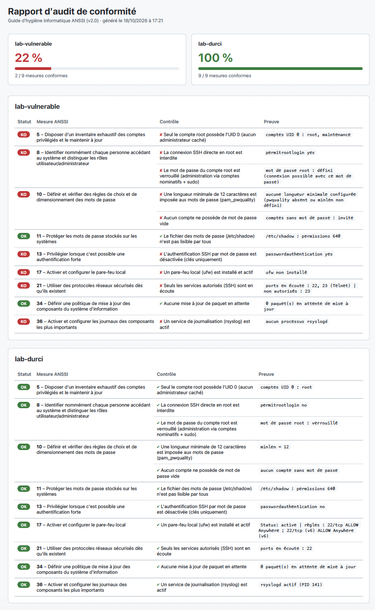

# Compliance Checker

Outil d'audit de conformité automatisé, écrit en Python. Il se connecte à des machines Linux, vérifie leur configuration de sécurité et rattache chaque résultat aux mesures du **Guide d'hygiène informatique de l'ANSSI**, avec une preuve pour chaque contrôle, un taux de conformité par machine et un rapport HTML.



> Projet personnel en cours de développement : il évoluera vers une plateforme web de conformité et d'analyse de risques (voir la [feuille de route](#feuille-de-route)).

## Fonctionnalités

- **Vérifications techniques automatisées** via SSH : configuration SSH, pare-feu, mises à jour, permissions de fichiers sensibles.
- **Rattachement à un référentiel** : chaque vérification est liée à une mesure du guide ANSSI, décrite dans un fichier YAML séparé du code.
- **Preuve pour chaque résultat** : la valeur réellement observée sur la machine est conservée, comme dans un audit.
- **Audit de plusieurs machines** décrites dans un fichier de configuration, avec synthèse comparative.
- **Authentification par clé SSH** avec un compte d'audit dédié (élévation de privilèges via `sudo`), ou par mot de passe.
- **Vérification de l'identité des serveurs** : seules les machines dont l'empreinte est enregistrée dans `known_hosts` sont auditées, ce qui protège contre l'attaque de l'homme du milieu.
- **Aucun secret dans le code** : les mots de passe sont lus dans des variables d'environnement (fichier `.env` non versionné).
- **Rapport HTML** généré avec Jinja2, avec échappement des preuves pour empêcher toute injection de code (XSS) depuis une machine auditée.
- **Architecture à plugins** : une vérification = un fichier, découvert automatiquement par le moteur.
- **Robustesse** : une vérification en erreur ou une machine injoignable n'interrompt pas l'audit.
- **Lab Docker** fourni : une machine volontairement vulnérable et une machine durcie pour comparer les résultats.

## Résultat sur le lab

```
=== Synthèse ===
  lab-vulnerable       22 %
  lab-durci            100 %
```

Les mêmes vérifications, appliquées à deux configurations différentes, mesurent concrètement l'effet du durcissement.

## Architecture

```
compliance-checker/
├── lab/
│   ├── vulnerable/Dockerfile   # Cible mal configurée (root, compte sans mot de passe, UID 0 caché, Telnet…)
│   └── durci/Dockerfile        # Cible durcie (compte d'audit, clé SSH, pare-feu)
├── checks/                     # Une vérification = un fichier (11 au total)
├── referentiels/
│   └── anssi.yaml              # Correspondance mesures ANSSI ↔ vérifications
├── templates/
│   └── rapport.html            # Template Jinja2 du rapport
├── cibles.yaml                 # Machines à auditer
├── .env.exemple                # Modèle du fichier de secrets (.env, non versionné)
├── connexion.py                # Connexion SSH (clé ou mot de passe) et exécution
├── rapport.py                  # Génération du rapport HTML
└── main.py                     # Moteur d'audit
```

**Fonctionnement :**

1. `main.py` découvre automatiquement les vérifications présentes dans `checks/`.
2. Pour chaque machine de `cibles.yaml`, il ouvre une connexion SSH et exécute toutes les vérifications.
3. Chaque vérification renvoie un résultat au format commun `{"conforme": bool, "preuve": str}`.
4. Les résultats sont croisés avec le référentiel YAML (`evaluer`).
5. Les mêmes données alimentent l'affichage console et le rapport HTML.

Séparer le code technique (les vérifications) du référentiel (le YAML) permet d'ajouter un nouveau référentiel, par exemple ISO 27001, sans réécrire les vérifications. De même, passer d'une authentification par mot de passe à une authentification par clé n'a demandé aucune modification des vérifications : seul `connexion.py` s'adapte.

## Vérifications actuelles

11 vérifications couvrant 9 mesures du guide (une mesure peut nécessiter plusieurs contrôles) :

| Mesure ANSSI | Vérification | Contrôle effectué |
|---|---|---|
| 5 | `uid0_unique` | Seul root possède l'UID 0 (aucun administrateur caché) |
| 8 | `ssh_root_login` | La connexion SSH directe en root est interdite |
| 8 | `root_verrouille` | Le mot de passe du compte root est verrouillé |
| 10 | `politique_mdp` | Une longueur minimale de 12 caractères est imposée (pam_pwquality) |
| 10 | `comptes_sans_mdp` | Aucun compte ne possède de mot de passe vide |
| 11 | `permissions_shadow` | `/etc/shadow` n'est pas lisible par tous |
| 13 | `ssh_password_auth` | L'authentification SSH par mot de passe est désactivée |
| 17 | `pare_feu` | Un pare-feu local (ufw) est installé et actif |
| 21 | `services_exposes` | Seuls les services autorisés (SSH) sont en écoute |
| 34 | `mises_a_jour` | Aucune mise à jour de paquet en attente |
| 36 | `journalisation` | Un service de journalisation (rsyslog) est actif |

Les vérifications lisent directement `/proc` et les fichiers système plutôt que de dépendre d'outils (`ss`, `pgrep`…) absents des installations minimales.

## Installation

Prérequis : Python 3.12+, Docker, Git.

```bash
git clone https://github.com/rkaseya/compliance-checker.git
cd compliance-checker
python3 -m venv .venv
source .venv/bin/activate
pip install -r requirements.txt
```

### Lancer le lab

Machine vulnérable :

```bash
docker build -t lab-cible lab/vulnerable/
docker run -d --name cible -p 127.0.0.1:2222:22 lab-cible
```

Machine durcie (la clé du compte d'audit est générée localement et n'est jamais versionnée) :

```bash
ssh-keygen -t ed25519 -f lab/durci/cle_audit -N "" -C "auditeur"
docker build -t lab-durci lab/durci/
docker run -d --name durci --cap-add=NET_ADMIN -p 127.0.0.1:2223:22 lab-durci
```

### Secrets et empreintes des serveurs

```bash
cp .env.exemple .env          # puis renseigner LAB_VULN_PASSWORD
ssh-keyscan -p 2222 127.0.0.1 >  known_hosts
ssh-keyscan -p 2223 127.0.0.1 >> known_hosts
```

L'outil refuse toute machine absente de `known_hosts` ou dont l'empreinte a changé. Avant de faire confiance à une empreinte, on la compare à celle lue directement sur la machine :

```bash
ssh-keygen -lf known_hosts
docker exec durci ssh-keygen -lf /etc/ssh/ssh_host_ed25519_key.pub
```

Après la reconstruction d'un conteneur, sa clé change : il faut supprimer l'ancienne ligne (`ssh-keygen -R "[127.0.0.1]:2223" -f known_hosts`) puis l'enregistrer à nouveau.

## Utilisation

```bash
python main.py
```

L'audit s'affiche dans le terminal et un rapport HTML horodaté est créé dans `rapports/`.

Les machines à auditer se déclarent dans `cibles.yaml` :

```yaml
cibles:
  - nom: lab-durci
    host: 127.0.0.1
    port: 2223
    user: auditeur
    cle: lab/durci/cle_audit

  - nom: lab-vulnerable
    host: 127.0.0.1
    port: 2222
    user: root
    password_env: LAB_VULN_PASSWORD   # lu dans .env, jamais écrit ici
```

## Interface web (Django)

Le même moteur est accessible depuis une interface web : tableau de bord, lancement d'un audit en un clic, historique et courbe d'évolution de la conformité, détail des preuves. Les résultats sont enregistrés en base et ne sont pas modifiables depuis l'interface.

```bash
pip install -r requirements.txt
echo "DJANGO_SECRET_KEY=$(python -c 'import secrets; print(secrets.token_urlsafe(50))')" >> .env
echo "DJANGO_DEBUG=1" >> .env
python manage.py migrate
python manage.py createsuperuser
python manage.py importer_cibles      # importe cibles.yaml en base
python manage.py lancer_audit         # audit en ligne de commande (optionnel)
python manage.py runserver
```

Puis ouvrir http://127.0.0.1:8000.

## Ajouter une vérification

1. Créer un fichier dans `checks/` respectant ce contrat :

```python
from connexion import executer

ID = "mon_controle"
DESCRIPTION = "Description lisible du contrôle"

def run(client):
    valeur = executer(client, "commande à exécuter sur la cible")
    return {"conforme": ..., "preuve": valeur}
```

2. Rattacher son `ID` à une mesure dans `referentiels/anssi.yaml`.

Aucune modification du moteur n'est nécessaire.

## Limites connues

- **Secrets** : le fichier `.env` reste un fichier en clair sur le poste de l'auditeur ; en entreprise, on utiliserait un gestionnaire de secrets (Vault, trousseau du système…).
- **Enregistrement des empreintes** : `ssh-keyscan` fait confiance à la première réponse reçue ; l'empreinte doit être vérifiée par un autre canal avant d'être acceptée.
- **Pare-feu en conteneur** : dans Docker, le filtrage est normalement assuré par l'hôte ; ce contrôle est surtout pertinent pour une VM ou un serveur physique.
- **Compte d'audit** : il dispose de `sudo` sans restriction ; en production, ses droits devraient être limités aux seules commandes d'audit.

## Feuille de route

- [x] Lab Docker et premières vérifications SSH
- [x] Moteur d'audit à plugins rattaché au guide ANSSI
- [x] Machine durcie, authentification par clé et audit multi-cibles
- [x] Rapport HTML
- [x] Vérification des clés d'hôte et gestion des secrets
- [x] Nouvelles vérifications (journalisation, politique de mots de passe, services exposés…)
- [ ] Export PDF du rapport
- [x] Interface web (Django) avec historique des audits
- [ ] Module d'analyse de risques inspiré d'EBIOS Risk Manager
- [ ] Ajout du référentiel ISO 27001 avec correspondances inter-référentiels
- [ ] Authentification, rôles et journal d'audit de l'application
- [ ] Pipeline CI/CD avec tests et analyse de sécurité (pytest, Bandit, pip-audit)

## Méthode de développement

Ce projet est réalisé avec l'assistance de Claude (Anthropic), qui a écrit la majeure partie du code en m'accompagnant étape par étape. Mon objectif est d'apprendre : comprendre chaque brique (SSH, durcissement Linux, référentiels de conformité, développement web sécurisé) et être capable d'expliquer les choix techniques. Je ne maîtrise pas encore toutes les opérations effectuées, et les retours sont les bienvenus.

## Avertissement

Cet outil est destiné à auditer des machines dont vous êtes propriétaire ou pour lesquelles vous disposez d'une autorisation explicite. La machine `lab/vulnerable` est volontairement vulnérable : ne l'exposez jamais sur un réseau.
